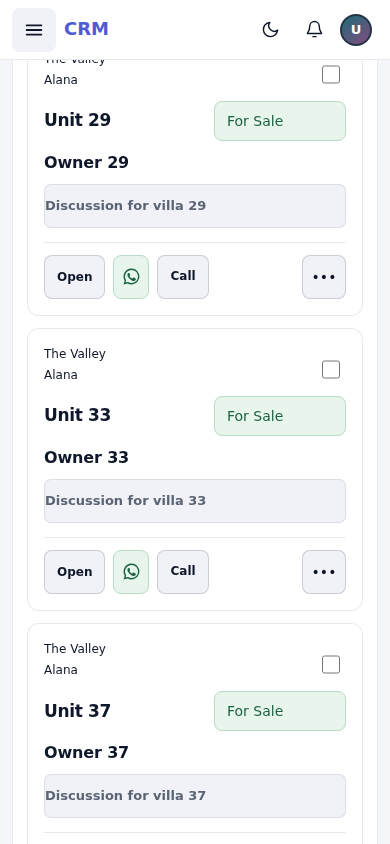
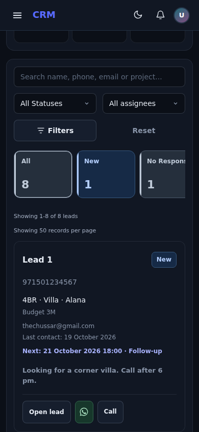
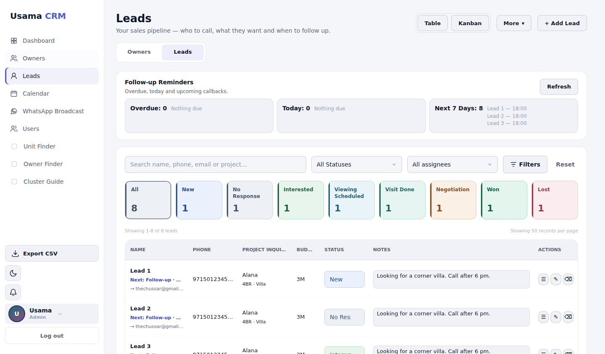
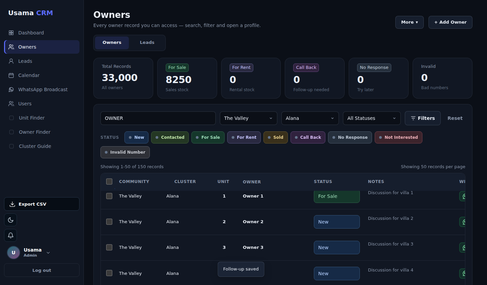

# Mobile workspace and UI refinement review

Branch: `chatgpt-ui-round`
Base: `1fa6ab342ebec6d4c2ca432a0efbc0beabfb9419` (`main`, checked again before handoff).
No merge, production deployment or database operation was performed.

## Root causes and changes

| Issue | Cause in the existing code | Change |
| --- | --- | --- |
| WhatsApp returns to the top | The contact handler called `loadData()`. `showLoading()` replaced 50 owner cards with four short skeletons, clamping document scroll. A second notes-render and related-row redraw compounded it. | Contact the owner using the existing DB operations, then update that row in place. Keep loaded rows mounted during refetch. Hydrate notes and related actions in place. |
| Browser tab reload loses work | Authentication startup always opened the launcher/dashboard. Filters, pagination and scroll existed only in globals/DOM. | User-scoped session metadata restores filters, dependent cluster options, sort, page, advanced-filter visibility, list anchor and open-record ID after authentication and module initialization. Fetch fresh RLS-filtered rows; never persist CRM records. |
| State hooks were bypassed | The V5 `showOnly` replacement discarded its base function. | Delegate to the shared view-switch function so all later wrappers share the lifecycle. |
| Mobile menu taps fail | The mobile header clipped its fixed drawer; the backdrop at z-index 1001 covered the entire header stacking context at 1000. | Remove header clipping, put backdrop below header, close the drawer after navigation, and maintain `aria-expanded`/Escape behavior. Add direct Owners/Leads workspace controls. |
| Theme/bell missing | Old mobile CSS explicitly used `.v7TopIcon { display:none }`. | Remove the hiding rule and provide compact visible global controls, using existing theme persistence and the real event-backed bell. |
| Notification count changes unexpectedly | A legacy 1.5-second timer and legacy activity refresh could overwrite the calendar event count. | Remove obsolete polling and delegate remaining refresh calls to `crmRefreshNotifications`. Notification clicks open the actual corresponding event editor, which links to its lead. |
| Owner table jumps | Conflicting auto-layout/min-width rules, repeated column-default resets, short skeletons and multiple complete renders. | Fixed table layout and row/note dimensions; shared saved widths; one page render; no collapsing skeletons. Main order: Community, Cluster, Unit, Owner, Status, Notes, WhatsApp, Actions. Last Contacted remains available as an optional column. |
| Colors differ by screen/theme | Several generations of selectors assigned different colors to the same status; stage colors depended on array position. | One semantic mapping and theme-aware palette in `crm-status-system.js`, reused on lists, details, filters, dashboard, pipeline and lead-linked calendar events. Unknown custom statuses use deterministic fallback colors. |
| Crowded mobile records | Desktop-oriented controls and large secondary information blocks dominated the screen. | Shared card rhythm, clear location/unit/name/status hierarchy, two-line note previews, compact WhatsApp action, touch actions and a More menu. Lead cards include requirements, assignment, last contact and next follow-up. Table/Kanban remains in mobile More. |

The existing eight Lead stages remain unchanged:
**New · No Response · Interested · Viewing Scheduled · Visit Done · Negotiation · Won · Lost**.

The existing server-side `owners_list` pagination (50 rows), filtering, access
rules, `unit_natural` ordering and stable ID tie-break remain in place. Request
versions prevent obsolete query responses from replacing newer results. Long
app switches revalidate without emptying the list; short switches retain its DOM.
Only visible-owner activity histories are paged, retaining at most two note
candidates per owner. Already-completed transaction appends do not repeat on login.

## Browser evidence

The complete suite passed in Chromium 153 with touch-enabled mobile contexts at
320, 375, 390 and 430 px, plus desktop at 1440 px. The actual CRM and Supabase
browser SDK ran against intercepted API fixtures. All 33,000 owners remained in
the test process; every listing request sent to the browser was limited to 50.

Twenty repeated WhatsApp round trips at villas 5, 20, 30, 40 and filtered villa 33
preserved the exact scroll value and the original card DOM node. An additional
round trip and reload on page 2 around villa 80 passed. Examples from the final
full-width run:

| Width | Villa | Scroll before | Scroll after |
| --- | --- | --- | --- |
| 320 | 30 | 9663 | 9663 |
| 375 | 30 | 9274 | 9274 |
| 390 | 30 | 9274 | 9274 |
| 430 | 30 | 9274 | 9274 |

The suite also checks:

- Real touch taps on drawer navigation and both Owner/Lead workspace switches.
- Document reload with community + cluster + search + source + status filters,
  pagination, expanded filters and position restored; theme remains selected.
- Natural order through 9 → 10 → 11 and natural-sort parameters in server queries.
- Visible theme and bell controls; notifications open and route to their event.
- Calendar form save reaches the API with the entered title.
- Profiles and lead detail open, fit the viewport and retain scroll containers;
  eight Lead stages remain; the occupancy log remains absent.
- Dashboard, Calendar, Users, profile settings and standalone Cluster Guide
  navigation/theme control; orientation/resizing of global controls.
- All known status text/background pairs exceed 4.5:1 in light and dark themes.
- An intentionally delayed obsolete search cannot overwrite newer results.
- Mobile page width does not overflow. Desktop Leads table client and scroll
  widths are both **1077 px** (no new horizontal overflow).
- No uncaught browser JavaScript errors. Syntax parsing and `git diff --check` pass.

Raw measurements: [browser-results.json](ui-round/browser-results.json).
Reproducible harness and limitations: [tests/README.md](../tests/README.md).

## Screenshots from the fixture-backed browser run

### Mobile Owners, light

### Mobile Leads, dark

### Desktop Leads, light

### Desktop Owners, dark

## Required preview / physical-device checks before merge

A native WhatsApp app was not available in this environment. The verified browser
flow opens the actual CRM WhatsApp URL in an intercepted external tab, switches
away/back repeatedly, and separately reloads the document. That is useful lifecycle
evidence, not proof of iOS Safari/Android process suspension or a native app handoff.

Claude should check the branch preview with an authorized account and a physical
phone: work around villa 30+, open native WhatsApp, return, repeat, then test Safari
back/forward and browser tab eviction. Verify real notification/event permissions
and deployed Supabase responses. These live integration checks were not simulated
as successful.

No SQL, migrations, Edge Functions, permission policies, owner merges, lead stage
data, secrets or historical records were changed. Existing merged owner data,
profile scrolling and removed occupancy UI were preserved.
